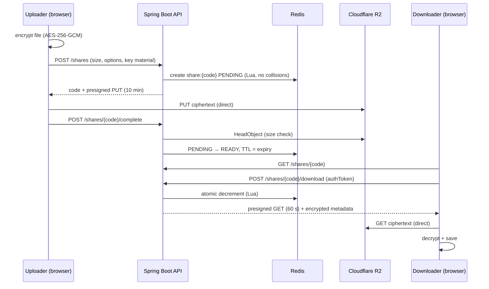

# Dropcode

Send a file from one device to another with a **5-character code**. Upload on your laptop, type `K7M2Q` on your phone, download. Files are **encrypted in the browser** before they leave the device, and they **never pass through the API server**.

- Codes use 31 unambiguous characters (no `0/O/1/I/L`), so they're easy to read aloud: ~28.6 M combinations.
- Choose 1/3/5/10 downloads and 10 min / 1 h / 24 h / 7 days expiry. Max 30 MB.
- Optional password → end-to-end encryption (the server can't decrypt).
- Arabic (RTL) and English, installable PWA, Android "Share to Dropcode".

## Architecture



| Layer | Tech |
|---|---|
| Backend | Java 25, Spring Boot 4, Spring Security, springdoc OpenAPI |
| Metadata | Redis (hashes with TTL, Lua scripts for atomic operations) |
| Files | Cloudflare R2 via AWS SDK v2 presigned URLs |
| Frontend | React 19, Vite, TypeScript, Tailwind CSS 4, Web Crypto, PWA |
| Abuse protection | Per-IP rate limits in Redis, Cloudflare Turnstile |
| Tests | JUnit 5, AssertJ, Mockito, Testcontainers, MockMvc, JaCoCo, Vitest, Testing Library, Playwright |
| CI / hosting | GitHub Actions, Railway (API + Redis), Cloudflare Pages, R2 |

### Encryption

| | Key | Server stores |
|---|---|---|
| **With password** | `PBKDF2-SHA256(password, salt, 600k)` → 64 bytes: first 32 = AES key (never leaves the device), last 32 = `authToken` | Argon2id hash of `authToken`, salt |
| **Without password** | random AES-256 key | the key (anyone with the code can decrypt; the UI says so) |

File name and type are encrypted too (`encMeta`). Payload = 12-byte IV ‖ AES-GCM ciphertext.

### Notable decisions

See [`docs/adr`](docs/adr):
1. [Files go straight to R2 with presigned URLs](docs/adr/0001-presigned-urls.md)
2. [Redis + Lua for atomic share state](docs/adr/0002-redis-lua.md)
3. [Client-side encryption](docs/adr/0003-client-side-encryption.md)
4. [Wrong passwords never lock a share](docs/adr/0004-no-share-lockout.md)

## API

`/api/v1/shares` (OpenAPI spec at `/v3/api-docs`). Errors are RFC 9457 `ProblemDetail` with a stable `code`.

| Method | Path | |
|---|---|---|
| POST | `/shares` | create → code + presigned PUT |
| POST | `/shares/{code}/complete` | verify upload → READY |
| GET | `/shares/{code}` | `protected`, `size`, `expiresAt`, `salt` |
| POST | `/shares/{code}/download` | `authToken` → presigned GET + `encMeta` (+ `fileKey`) |

Unknown, pending, expired and used-up codes all return the same 404.

## Run locally

Requirements: Java 25, Docker, Node 24 (`frontend/.nvmrc`).

```bash
docker compose up -d                       # Redis
cd backend && cp .env.example .env         # fill in R2 credentials
./gradlew bootRun                          # http://localhost:8080
```

```bash
cd frontend && npm install && npm run dev  # http://localhost:5173
```

Tests:
- Backend: `./gradlew check` (needs Docker for Testcontainers; also enforces 85% line coverage, report in `build/reports/jacoco`).
- Frontend unit/component: `npm test`.
- Browser E2E: `npx playwright install chromium` once, then `npm run test:e2e`. It runs the built app in Chromium (desktop + mobile) with the API, R2 and Turnstile faked, and checks that only ciphertext reaches storage.
The real-R2 integration test runs only when the R2 variables are exported:
`set -a && source .env && set +a && ./gradlew test --tests '*R2StorageServiceIT'`.

## Deploy

See [docs/deploy.md](docs/deploy.md).
